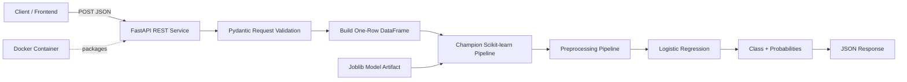

# Customer Churn Prediction — Real-Time Inference API

A Dockerized FastAPI microservice that serves the **champion Customer Churn classification pipeline** from the preceding model-tuning task. The service accepts customer attributes and returns a binary churn prediction with probabilities for both classes.

> **Important model limitation:** The supplied training dataset contains only 12 records (7 non-churned and 5 churned). The model is suitable for demonstrating an end-to-end ML deployment workflow and API integration, but its predictions and reported training/evaluation results are not reliable production evidence. Do not use it to make real customer-retention decisions without a larger, representative, properly governed dataset and fresh validation.

## 1. Project structure

```text
customer_churn_inference_api/
├── app/
│   ├── __init__.py
│   └── main.py
├── models/
│   └── champion_customer_churn_model.joblib
├── tests/
│   ├── conftest.py
│   └── test_api.py
├── Dockerfile
├── .dockerignore
├── .gitignore
├── requirements.txt
├── data_sample.csv
└── README.md
```

`data_sample.csv` is included only as project provenance/example input. It is not copied into the Docker image and is not required by the inference service.

## 2. Champion model

The API loads the previously serialized scikit-learn `Pipeline` from `models/champion_customer_churn_model.joblib`. The artifact contains:
- Numeric preprocessing for `tenure_months`, `support_tickets`, `monthly_spend_inr`, and `last_login_days` (median imputation and standard scaling).
- Categorical preprocessing for `plan_type` (most-frequent imputation and one-hot encoding).
- Logistic Regression classifier.

The API uses the pipeline's `predict()` and `predict_proba()` methods. Preprocessing is therefore applied consistently at inference time. The serialized artifact must come from a trusted source because Joblib model files use Python pickle serialization.

## 3. System architecture



### Request lifecycle
1. A client sends customer attributes to `POST /predict`.
2. FastAPI/Pydantic validates required fields, types, ranges, and allowed plan names.
3. The service creates a one-row pandas DataFrame in the model's expected feature format.
4. The champion pipeline performs preprocessing and classification.
5. The API maps probabilities to class labels (`0` and `1`) and returns a structured JSON response.

## 4. Input contract

| Field | Type | Constraints | Meaning |
|---|---|---|---|
| `tenure_months` | integer | 0–1200 | Customer tenure in months |
| `support_tickets` | integer | 0–100000 | Number of support tickets |
| `monthly_spend_inr` | number | 0–100000000 | Monthly spend in INR |
| `last_login_days` | integer | 0–36500 | Days since last login |
| `plan_type` | string | `Basic`, `Standard`, `Pro` | Subscription plan |

Unknown fields are rejected. All five model features are required.

## 5. Run locally

Requires Python 3.12.

```bash
# Create and activate a virtual environment
python -m venv .venv

# Windows PowerShell
.venv\Scripts\Activate.ps1

# macOS / Linux
source .venv/bin/activate

# Install exact pinned dependencies
pip install -r requirements.txt

# Start the API
uvicorn app.main:app --host 127.0.0.1 --port 8000 --reload
```

Open:
- Interactive Swagger UI: http://127.0.0.1:8000/docs
- ReDoc: http://127.0.0.1:8000/redoc
- Health check: http://127.0.0.1:8000/health

## 6. API reference

### `GET /`
Returns service name and documentation/health paths.

Example response:
```json
{
  "message": "Customer Churn Prediction API",
  "docs": "/docs",
  "health": "/health"
}
```

### `GET /health`
Returns service health and model-load status.

Example response:
```json
{
  "status": "healthy",
  "model_loaded": true
}
```

### `POST /predict`
Predicts whether the supplied customer is likely to churn.

Example request:
```json
{
  "tenure_months": 12,
  "support_tickets": 2,
  "monthly_spend_inr": 999.0,
  "last_login_days": 5,
  "plan_type": "Standard"
}
```

Example response shape (probability values below are illustrative):
```json
{
  "prediction": 0,
  "prediction_label": "not_churned",
  "probabilities": {
    "not_churned": 0.73,
    "churned": 0.27
  },
  "model_name": "champion_customer_churn_model",
  "model_version": "1.0.0"
}
```

The actual probability values are computed by the loaded model and will depend on the input. `prediction` is `0` for `not_churned` and `1` for `churned`. The two probabilities sum to approximately 1.0.

### HTTP status codes

| Code | Meaning |
|---|---|
| `200` | Prediction or health request succeeded |
| `404` | Unknown endpoint |
| `422` | Invalid JSON, missing field, wrong type, out-of-range value, or unsupported plan |
| `500` | Prediction failed inside the service |

FastAPI also exposes the OpenAPI schema at `/openapi.json`.

## 7. Example request with cURL

```bash
curl -X POST "http://127.0.0.1:8000/predict" \
  -H "Content-Type: application/json" \
  -d '{
    "tenure_months": 12,
    "support_tickets": 2,
    "monthly_spend_inr": 999.0,
    "last_login_days": 5,
    "plan_type": "Standard"
  }'
```

## 8. Automated tests

The test suite checks:
- Root and health endpoints.
- Prediction response schema and value ranges.
- Probability sum.
- Prediction label/class consistency.
- Missing fields.
- Negative numeric input.
- Unsupported plan values.
- Unexpected fields.

Run tests:

```bash
pytest -v
```

## 9. Docker

Build the image:

```bash
docker build -t customer-churn-api:1.0 .
```

Run the container:

```bash
docker run --rm -p 8000:8000 customer-churn-api:1.0
```

Verify:

```bash
curl http://localhost:8000/health
```

Then open http://localhost:8000/docs.

The Docker image uses a pinned Python dependency set, a slim Python 3.12 base image, a non-root runtime user, and a container health check.

## 10. GitHub submission

Create a new GitHub repository, for example `customer-churn-inference-api`, then run from this project directory:

```bash
git init
git add .
git commit -m "Build Dockerized FastAPI customer churn inference service"
git branch -M main
git remote add origin https://github.com/<YOUR-USERNAME>/customer-churn-inference-api.git
git push -u origin main
```

Do not commit secrets, credentials, or customer-identifiable production data. The model artifact is included because it is required to reproduce this capstone; only publish it if you are authorized to share it.

## 11. Production-readiness checklist

This repository demonstrates model serving, validation, tests, containerization, and API documentation. Before real production use, add:
- A substantially larger and representative training dataset with documented consent, provenance, and retention.
- Independent temporal/holdout validation, calibration checks, subgroup performance and drift monitoring.
- Authentication, authorization, rate limiting, TLS termination, request-size limits, and audit logging.
- Model registry/version governance, artifact integrity checks, rollback strategy, and CI/CD.
- Monitoring for latency, error rate, input drift, prediction distribution, and service availability.
- A privacy/security review and a documented human review process for consequential customer actions.

## 12. Reproducibility note

The serialized model was produced in the preceding model-tuning task. Dependency versions are pinned in `requirements.txt` to reduce serialization/runtime incompatibilities. If the model is retrained, regenerate the artifact and re-run the full test suite in the target runtime before deployment.
